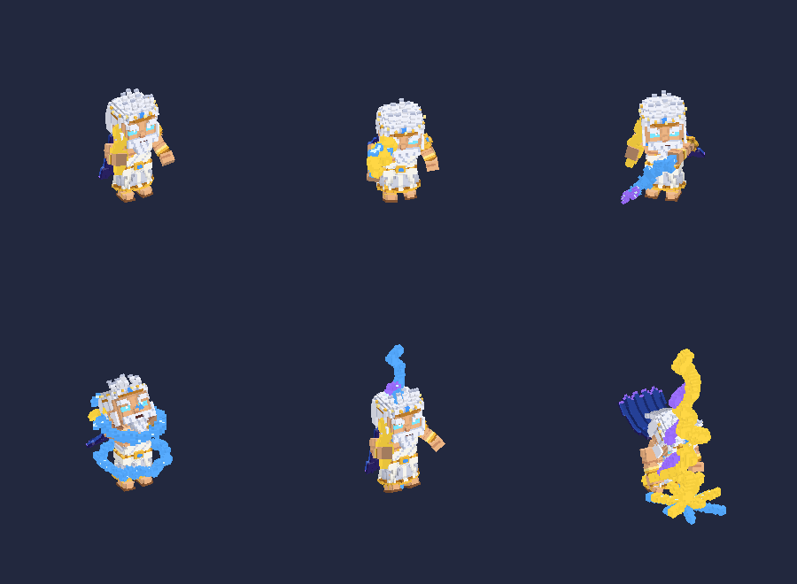

# Zeus: custom character for Esports Godfather

Zeus is a storm mage. He is an original **voxel** hero built to match Esports
Godfather's native style: chunky voxels, chibi proportions, a strong
silhouette. His lightning kit is built into the model as animated effects.



## Quick start

```
python3 tools/build_zeus.py
```

That builds everything into `build/`:
- `build/ImportedModels/Zeus/`: the lab folder (`model.bin.gz`, `Zeus_Palette.png`, `materials.txt`)
- `build/zeus_preview_front.png` and `build/zeus_preview_game.png`: every clip, rendered offline
- `build/zeus_voxel.glb`: rig plus animations, which you can open in Blender

To install, put that `Zeus` folder next to `lab/step7/INSTALL_STEP7_CLEAN_MODEL_PASS.cmd`
and run the installer. In the game's ZeusLab panel, click **Zeus Prototype**.

## Editing Zeus (MagicaVoxel, no rigging needed)

The source is `zeus/`:

| File | What it is |
|---|---|
| `zeus/parts/<Bone>.vox` | One MagicaVoxel model per bone (Head, Jaw, Spine2, R_Elbow, ...) |
| `zeus/rig.json` | Bone pivots, where each part sits, which palette slots glow |
| `zeus/anims.py` | All animation clips and the lightning FX timing |

1. Open `zeus/parts/Head.vox` (or any part) in [MagicaVoxel](https://ephtracy.github.io/), edit it and save.
   - Parts open upright and un-mirrored. The part is placed by its `anchor` in
     `rig.json`, and resizing the model in MagicaVoxel keeps existing voxels in place.
     If a part ever shifts after an edit, nudge its `anchor` ([x, y, z] in voxels).
   - Palette slots 15–20 and 22–23 are **emissive**: eyes, lightning and gems stay
     at full brightness. Recolor freely, but keep glow colors in those slots.
2. Run `python3 tools/build_zeus.py` and check the preview PNGs.
3. Re-run the installer.

Each part is rigidly attached to its bone, the same way the game's own voxel
heroes are animated, so you never paint weights.
`tools/seed_zeus_voxels.py --force` regenerates the original parts, which
**overwrites your edits**.

### The kit (clip names follow the lab's existing convention)

| Clip | Move | What happens |
|---|---|---|
| Idle | — | Hovering stance, bolt raised, sparks crackling on the bolt and left hand |
| Run | — | Run cycle, cape and mane streaming |
| Attack | **Lightning Bolt** | Winds up and hurls the bolt (projectile), then a new one sparks into his hand |
| Q | **Chain Lightning** | Turns side-on, and an arc leaps from his left hand through 3 targets with a burst on the last |
| W | **Static Aegis** | Arms to the sky, and two electric rings spin up around him |
| E | **Thunder Step** | Crouches, lightning strikes him, he vanishes, then is struck again and re-forms |
| R | **Wrath of Olympus** | Levitates, gathers a storm ring overhead, slams. A sky bolt strikes ahead and the ground explodes |
| Taunt | — | Booming laugh with lightning dancing on the raised bolt |
| Death | — | Sparks die out and he collapses |

The FX bones are hidden at rest (scale ≈ 0, parked inside the body), so they
never affect the lab camera's framing. Attach points for in-game VFX are
`FX_BoltTip`, `FX_Chest`, `FX_Overhead` and `FX_Ground`.

### Bake notes

The lab renders with `Unlit/Texture`, so lighting is **baked** into
`Zeus_Palette.png`:
- each color has 16 brightness rows
- every voxel face picks a row from its direction (top bright, bottom dark)
- ambient occlusion from neighboring voxels darkens creases
- faces are greedy-meshed: about 6.5k triangles for the body and 14.7k for all FX

If the real game renderer is lit, set the shading in `tools/voxel.py` (`DIRS`)
to 1.0 so lighting isn't applied twice.

## Tools

| Tool | Purpose |
|---|---|
| `tools/build_zeus.py` | Runs everything: voxel → glb → KAIR → previews |
| `tools/voxel_build.py` | `rig.json` + `.vox` + `anims.py` → rigged, animated `.glb` |
| `tools/gltf_to_kair.py` | Any rigged `.glb` (Blender, Mixamo, ...) → KAIR lab folder |
| `tools/kair.py inspect` | Validates a KAIR model |
| `tools/kair_preview.py` | Offline renders; `--pitch 30 --yaw -30` gives the game camera |
| `tools/make_zeus_blockout.py` | The earlier smooth (non-voxel) Zeus, kept for reference |

## What was wrong with the Step 7 Zeus prototype

`tools/kair.py inspect ZeusPrototype.model-rigged.bin.gz` shows:

| | |
|---|---|
| Skeleton | **Janna's** 361-bone rig (wings, frost staff, crow VFX bones) |
| Animations | **Janna's** Idle/Run/Attack/Q/W/E/R/Taunt/Death |
| Mesh | 258 triangles of boxes on 14 of the 361 bones. The other 18 mesh slots are empty one-triangle placeholders |

So the prototype was never a Zeus model. It was box primitives driven by a
League of Legends rig. That explains why it looked janky, and it means it
can't ship as an original character. The voxel Zeus above replaces it.

## glTF pipeline (Blender / Mixamo models)

```
Blender / any DCC ──export .glb──► tools/gltf_to_kair.py ──► ImportedModels/Zeus/
                                                              model.bin.gz
                                                              *.png
                                                              materials.txt
tools/kair_preview.py  renders contact sheets without launching the game
tools/kair.py inspect  validates a model (bones, weights, clips, placeholders)
```

The converter handles these conversions:

- glTF right-handed to Unity left-handed (mirror X, flip triangle winding)
- UV origin flip
- folding armature transforms (Mixamo's 0.01 scale, Blender's -90° X) into the root bone
- 30 FPS resampling with continuous quaternions
- 4-influence weight normalisation
- 8-influence to 4-influence reduction
- rigid props parented to bones (e.g. a weapon on the hand)
- `--height` rescaling
- writing `materials.txt` so each mesh gets its texture

## Reference mod note

The uploaded "reference" zip (`3774304166`) is *Silverbear's Champion
Collection* for **Teamfight Manager 2**, not Esports Godfather. It is not
Sixfold (`3798453402`). It uses 64×64 pixel-art sprite sheets (`#sheet.png` +
`#anim.fanim`) and JSON `.data_champion` kits, so none of its formats load in
Esports Godfather.
