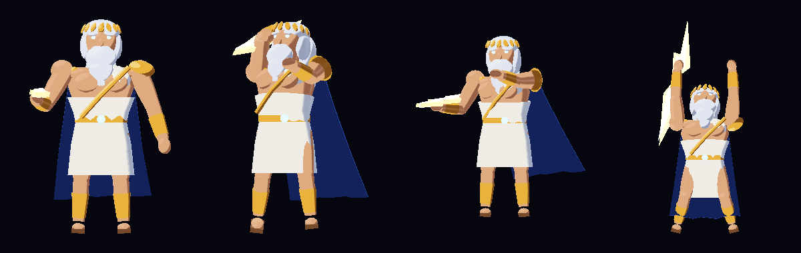

# Zeus: custom character for Esports Godfather

ZeusLab is a C# mod (`lab/step7/MyModScript.cs`) that loads rigged 3D models
in the **KAIR** format and previews them in-game (`RealModelLab`). This repo
adds an original Zeus character and a tool pipeline. With it, any model made
in Blender (or another glTF tool) reaches the game with correct orientation,
scale, skinning and 30 FPS animation.



## What was wrong with the Step 7 Zeus prototype

`tools/kair.py inspect ZeusPrototype.model-rigged.bin.gz` shows:

| | |
|---|---|
| Skeleton | **Janna's** 361-bone rig (wings, frost staff, crow VFX bones) |
| Animations | **Janna's** Idle/Run/Attack/Q/W/E/R/Taunt/Death |
| Mesh | 258 triangles of boxes on 14 of the 361 bones. The other 18 mesh slots are empty one-triangle placeholders |

So the prototype was never a Zeus model. It was box primitives driven by a
League of Legends rig. That explains why it looked janky, and it means it
can't ship as an original character. The original blockout below replaces it.

## The pipeline

```
Blender / any DCC ──export .glb──► tools/gltf_to_kair.py ──► ImportedModels/Zeus/
                                                              model.bin.gz
                                                              *.png
                                                              materials.txt
tools/kair_preview.py  renders contact sheets without launching the game
tools/kair.py inspect  validates a model (bones, weights, clips, placeholders)
```

The converter handles these conversions:

- glTF right-handed to Unity left-handed (mirror X, flip triangle winding)
- UV origin flip
- folding armature transforms (Mixamo's 0.01 scale, Blender's -90° X) into the root bone
- 30 FPS resampling with continuous quaternions
- 4-influence weight normalisation
- 8-influence to 4-influence reduction
- rigid props parented to bones (e.g. a weapon on the hand)
- `--height` rescaling
- writing `materials.txt` so each mesh gets its texture

### Rebuild the original Zeus blockout

```
python3 tools/make_zeus_blockout.py build/zeus_blockout.glb
python3 tools/gltf_to_kair.py build/zeus_blockout.glb build/ImportedModels/Zeus --height 1.0
python3 tools/kair_preview.py build/ImportedModels/Zeus build/zeus_sheet.png
```

To install it, copy `build/ImportedModels/Zeus` next to
`INSTALL_STEP7_CLEAN_MODEL_PASS.cmd` as a folder named `Zeus` and run the
installer. The installer now uses that folder instead of the old prototype.

### Zeus blockout spec (match this when making the final model)

- **Rig (30 bones):** Root, Pelvis, Spine1-2, Neck, Head, Jaw, Shoulder/Elbow/Hand ×2, R_Weapon,
  Hip/Knee/Foot ×2, Skirt_F/B, Cape1-3, HairBack, plus FX attach points
  (FX_BoltTip, FX_Chest, FX_Overhead, FX_Ground). The rest pose has identity rotations.
- **Clips:** Idle 2.4s loop, Run 0.6s loop, Attack 1.0s (release at 0.48s), Q 1.0s,
  W 1.0s, E 1.0s, R 1.6s (impact at 1.15s), Taunt 2.0s, Death 1.6s.
- **Scale:** 1.0 unit tall, faces +Z, the same framing as the other lab models.
- **Materials:** Skin, Hair, Cloth, Gold, Leather, Cape, CapeInner, Eyes, Bolt, BoltCore.
  These are toon "matcap" textures because the lab renders with `Unlit/Texture`.

## Making the final, great-looking model

The blockout is correct and animates cleanly, but it is built from primitives.
To make it look great, do the following in Blender:

1. Import `build/zeus_blockout.glb`. It brings in the rig, all clips and the proportions.
2. Sculpt or model the real Zeus on top of it and skin it to the **same bones**,
   then keep or polish the clips (the names must stay the same).
3. Export as glTF Binary with *Include: Selected/Visible*, *+Y Up*, and
   *Animation: Actions/NLA* enabled. Then run `gltf_to_kair.py`.

Mixamo characters and animations also convert. Rename the clips with
`--rename "Armature|mixamo.com|Layer0=Idle"`.

## Reference mod note

The uploaded "reference" zip (`3774304166`) is *Silverbear's Champion
Collection* for **Teamfight Manager 2**, not Esports Godfather. It is not
Sixfold (`3798453402`). It uses 64×64 pixel-art sprite sheets (`#sheet.png` +
`#anim.fanim`) and JSON `.data_champion` kits, so none of its formats load in
Esports Godfather.
